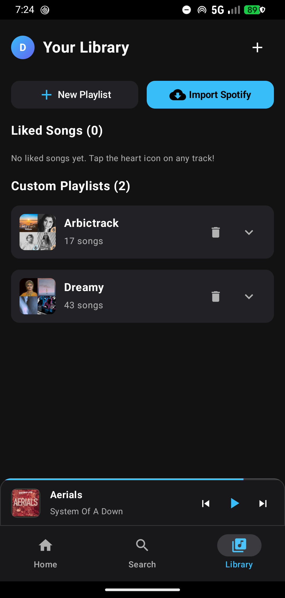
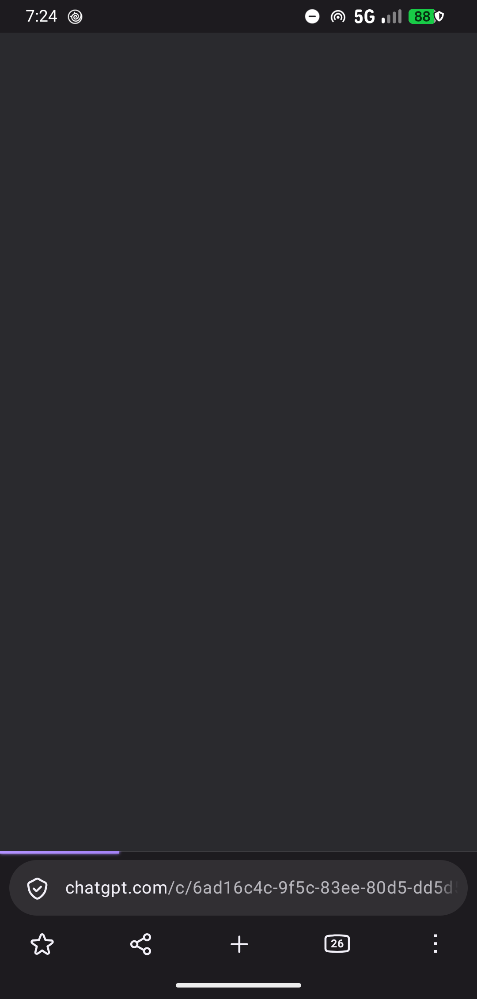
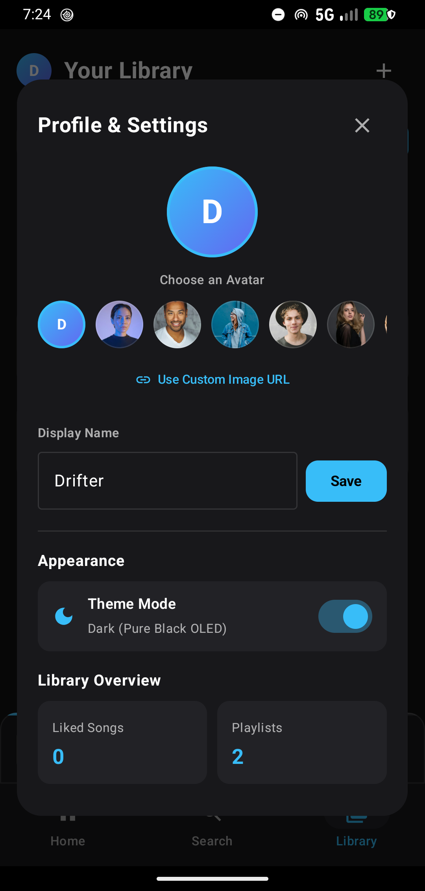
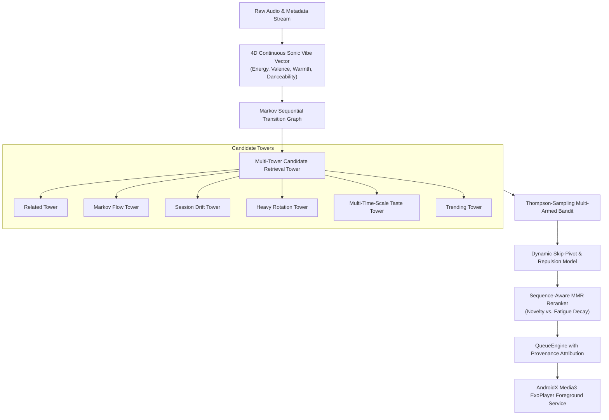

# 🌊 Drift Music

> **Next-Generation Autonomous Music Streaming & Discovery Engine for Android.**  
> *Formerly Soundify — Completely reimagined as a native Android experience powered by a sequence-aware algorithmic engine.*

[-3DDC84?style=for-the-badge&logo=android&logoColor=white)](https://android.com)
[](https://kotlinlang.org)
[](https://developer.android.com/jetpack/compose)
[](https://developer.android.com/guide/topics/media/media3)
[](LICENSE)
[](https://github.com/seninalikp)

---

## 📦 Download Drift APK

Get the latest signed APK directly and install it on your Android device:

| Release | Version | Direct Download |
| :--- | :--- | :--- |
| **Latest Release** | **v1.0.0** | [⬇️ **Download Drift-v1.0.0.apk**](https://github.com/seninalikp/soundify/releases/download/v1.0.0/Drift-v1.0.0.apk) |

*(Supports Android 8.0 Oreo through Android 15)*

---

## 📸 Screenshots

| Sonic Flow Home | Interactive Now Playing | Apple Music-Style Library | Profile & Customization |
| :---: | :---: | :---: | :---: |
|  |  |  |  |

---

## ⚡ Next-Gen Recommendation Architecture

Drift moves beyond static playlists and linear shuffle algorithms by introducing a full **on-device contextual music intelligence stack**:



### 1. 4D Continuous Sonic Vibe Vector (`SonicVector`)
- Models Spotify-style audio descriptors locally from acoustic cues, tags, key titles, and tempo.
- Dimensions: `energy` (0.0–1.0), `valence` (0.0–1.0), `warmth` (0.0–1.0), `danceability` (0.0–1.0).
- Calculates continuous Euclidean cosine similarity to steer queue transitions without jarring genre clashes.

### 2. Markov Sequential Transition Graph
- Builds a directed graph tracking pairs of tracks listened to in sequence.
- Applies edge-frequency weighting with log-scaled dampening and dynamic clustering to discover natural track transitions.

### 3. Real-Time RAM Session Model with Skip Repulsion
- Tracks listening velocity in memory across your current listening session.
- When you skip a song within the first 15 seconds, a negative repulsion vector is immediately applied to push similar tempos and genres out of upcoming queue slots.
- **Skip Pivot:** A 3-skip streak automatically triggers an exploratory pivot to fresh candidate pools.

### 4. Sequence-Aware Maximal Marginal Relevance (MMR)
- Avoids repetitive artist exhaustion using exponential fatigue penalties:
  $$\text{Penalty}(A) = \text{base} \times e^{-\lambda \cdot \Delta t}$$
- Guarantees diverse, fatigue-resistant playback queues.

### 5. Two-Level BaRT-Style Contextual Shelf Bandits
- Level 1: Generates candidate shelves concurrently (*Heavy Rotation, Made For You, Sonic Flow, Daypart Mix, Genre Mixes, Discovery*).
- Level 2: Dynamically re-orders shelves using Thompson-sampling bandits based on actual card clicks vs. scroll impressions.

---

## 🎨 Native UI & Playback Features

- **1:1 Draggable Finger Gesture Physics:** The now-playing bottom sheet sticks directly to your finger with spring velocity snapping.
- **Apple Music-Style Hierarchical Library:** Instant drilldown into Playlists, Liked Songs, Artists, Albums, and Downloads.
- **Unified Profile Centerpiece:** Interactive circular avatar with native gallery picker, smart 512×512 downsampling, and persistent disk storage.
- **Adaptive Appearance:** OLED Pure Black Dark Mode and Clean Radiant Light Mode.
- **True Wall-Clock Play Accumulator:** Audio playback is tracked with `SystemClock.elapsedRealtime()` so background pauses never inflate listening statistics.
- **Double-Buffer Prefetching:** Pre-loads the next 2 audio tracks in the background for zero-latency gapless transitions.

---

## 🛠️ Project Structure

```
soundify/
├── app/
│   ├── src/main/
│   │   ├── java/com/soundify/player/
│   │   │   ├── music/               # Core Algorithm (CoreAndTaste, Learning, Candidates, Ranker, QueueEngine, HomeBuilder)
│   │   │   ├── ui/                  # Jetpack Compose UI (Screens, Sheets, Library, Theme, Profile)
│   │   │   ├── service/             # AndroidX Media3 ExoPlayer Foreground Service
│   │   │   ├── data/                # Room DB, EventLog, BlockedItems, SharedPreferences
│   │   │   ├── model/               # Immutable Track, Shelf, Artist Models
│   │   │   └── api/                 # Music stream resolvers & scrapers
│   │   └── AndroidManifest.xml
│   └── build.gradle.kts
├── .github/workflows/
│   └── release.yml                  # Automated CI/CD: Builds and publishes signed APK releases
├── archive/
│   └── legacy_web/                  # Preserved React/Vite web application archive
├── docs/
│   └── screenshots/                 # Application visual documentation
├── build.gradle.kts
├── settings.gradle.kts
└── README.md
```

---

## 🏛️ Legacy Web Archive

The original React/Vite/TypeScript web application of Soundify has been cleanly archived:
- In this repository under [`archive/legacy_web/`](archive/legacy_web/)
- In the dedicated branch [`archive/web-legacy`](https://github.com/seninalikp/soundify/tree/archive/web-legacy)

---

## ⚙️ Building from Source

### Prerequisites
- JDK 17 or higher
- Android SDK (API 34)
- Gradle 8.9 (included via wrapper)

### Build Steps
```bash
# Clone the repository
git clone https://github.com/seninalikp/soundify.git
cd soundify

# Build Debug APK
./gradlew assembleDebug

# Build Signed Release APK
./gradlew assembleRelease
```
The output APK will be generated at:
`app/build/outputs/apk/release/app-release.apk`

---

## 👤 Author & Credits

- **Creator & Developer:** [Senin Ali KP](https://github.com/seninalikp) (`@seninalikp`)
- **Contact / GitHub:** [https://github.com/seninalikp](https://github.com/seninalikp)

---

## 📄 License

This project is open-source software licensed under the [MIT License](LICENSE).
